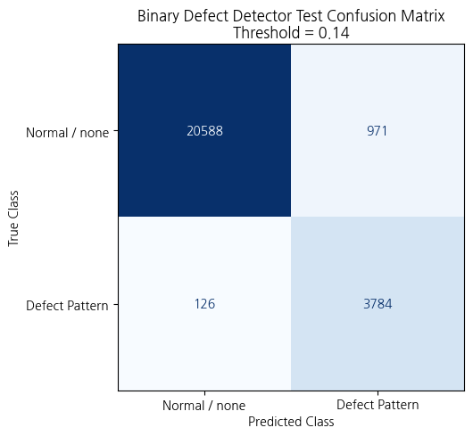
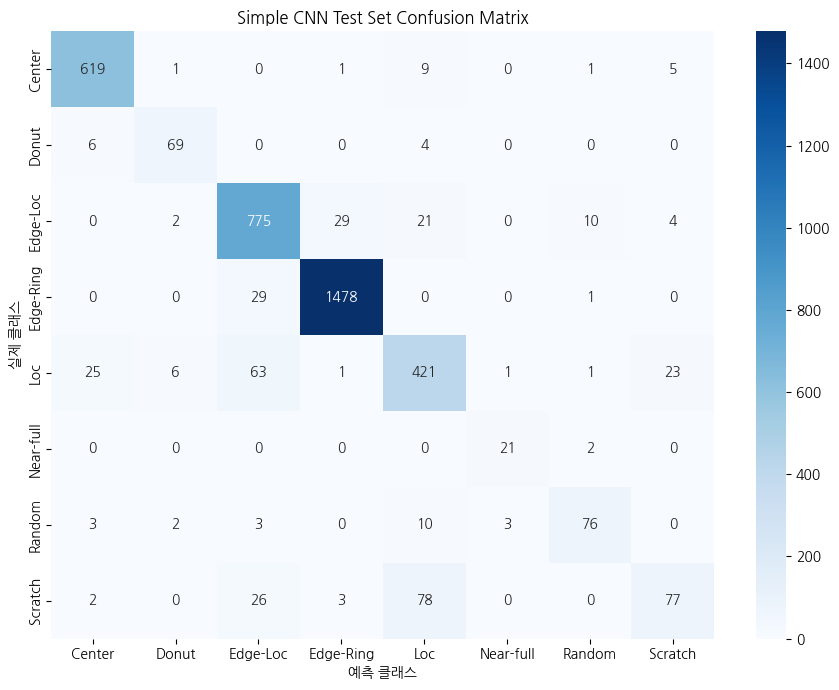
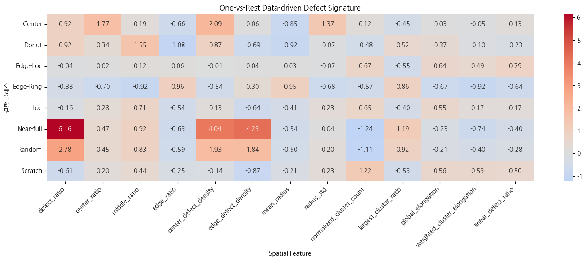
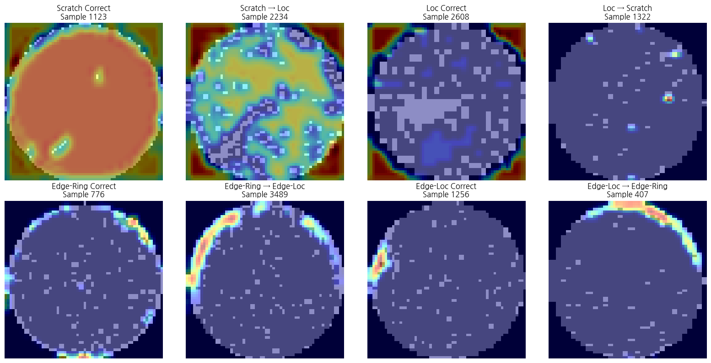
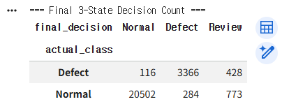

# Explainable Wafer Map Failure Pattern Diagnosis

## Overview

This project develops an explainable **wafer map failure pattern diagnosis pipeline** using the WM-811K dataset.

Rather than relying only on a single CNN prediction, the framework combines:

- Binary defect screening
- 8-class CNN classification
- Spatial pattern analysis
- Grad-CAM visualization
- Reliability assessment
- Normal / Defect / Review decision logic
- Root-cause investigation candidates

The goal is to build a diagnosis pipeline that not only predicts a wafer failure pattern, but also provides evidence for whether the prediction should be trusted.

---

## Project Objectives

The project addresses four main questions:

1. Can a wafer map be screened reliably as Normal or Defect?
2. Can defective wafer maps be classified into known failure patterns?
3. Can spatial information and Grad-CAM provide interpretable evidence for CNN predictions?
4. Can uncertain or atypical wafers be routed to Review instead of forcing an automatic diagnosis?

---

## Dataset

This project uses the **WM-811K wafer map dataset**.

Each wafer map contains die-level information:

```text
0 = Outside wafer
1 = Normal die
2 = Defective die
```

The maps were normalized and resized to a common image size for CNN training.

After preprocessing and duplicate handling, the modeling dataset contained approximately:

**25,422 unique labeled wafer maps**

The failure-pattern classes analyzed in this project were:

- Center
- Donut
- Edge-Loc
- Edge-Ring
- Loc
- Near-full
- Random
- Scratch

Normal wafers were additionally used for binary screening.

---

## Analysis Pipeline

```text
Wafer Map
    ↓
Preprocessing
    ↓
Binary Normal / Defect Screening
    ↓
8-Class CNN Failure Pattern Classification
    ↓
Spatial Feature Analysis
    ↓
Grad-CAM
    ↓
Reliability Assessment
    ↓
Normal / Defect / Review
    ↓
RCA Investigation Candidates
```

---

## 1. Wafer Map Preprocessing

Wafer maps originally had different dimensions.

To provide a consistent CNN input, each map was transformed into a normalized image representation and resized to:

```text
64 × 64
```

The die states were encoded while preserving the distinction between:

- wafer background
- normal dies
- defective dies

Duplicate wafer maps were removed to reduce evaluation leakage.

---

## 2. Data Split Strategy

The dataset was separated so that model evaluation would reflect generalization rather than memorization of highly similar wafer maps.

A lot-aware split strategy was used where applicable to reduce leakage between related wafer samples.

The final test set remained separated from model development.

---

## 3. Binary Defect Screening

Before performing detailed pattern classification, a binary CNN was used to determine whether a wafer should be treated as:

```text
Normal
or
Defect Candidate
```

A probability threshold of:

```text
0.12
```

was selected for defect screening.

The final test defect recall was approximately:

```text
96.83%
```

This stage was designed to prioritize the detection of defective wafers and reduce the probability that a true defect would be classified directly as Normal.

---
### Binary Screening Result



## 4. 8-Class Failure Pattern Classification

Wafer maps classified as defect candidates were analyzed using a CNN trained on eight failure-pattern classes.

The final Simple CNN achieved:

```text
Test Accuracy   = 0.9085
Macro F1-score  = 0.8481
```

The model demonstrated strong overall classification performance while still showing class-dependent differences in difficulty.

---
### Classification Result



## 5. Spatial Pattern Analysis

CNN probability alone does not guarantee that a wafer follows the expected geometric characteristics of a failure pattern.

Therefore, spatial features were extracted from each wafer map.

Examples include characteristics related to:

- radial defect distribution
- center concentration
- edge concentration
- angular localization
- spatial spread

These features were used to construct representative spatial prototypes for each failure class.

A new wafer could then be compared with the expected spatial structure of the predicted class.

---
### Spatial Prototype


### Defect Signature



## 6. Grad-CAM Interpretation

Grad-CAM was applied to visualize which regions of the wafer map contributed to the CNN classification.

This allows the prediction to be checked visually.

For example:

```text
CNN Prediction
    ↓
Edge-Loc

Grad-CAM
    ↓
Model attention concentrated near the wafer edge
```

If the CNN prediction, spatial pattern, and Grad-CAM evidence agree, confidence in the automatic diagnosis increases.

Grad-CAM is used as interpretability evidence rather than proof of physical causality.

---
### Grad-CAM Examples



## 7. Reliability Assessment

A high softmax probability alone does not necessarily imply a reliable diagnosis.

The project therefore combines several signals when evaluating prediction reliability:

- CNN confidence
- Top-1 / Top-2 prediction relationship
- Spatial prototype agreement
- Prototype distance
- Grad-CAM behavior
- Binary screening result

The objective is to identify wafers that do not closely resemble the training distribution or that show conflicting diagnostic evidence.

---

## 8. Final Normal / Defect / Review Decision

Instead of forcing every wafer into a final automatic diagnosis, the pipeline uses three operational states:

```text
Normal
Defect
Review
```

### Final Test Results

For actual defective wafers:

| Final Decision | Count | Ratio |
|---|---:|---:|
| Normal | 124 | 3.17% |
| Defect | 3,306 | 84.55% |
| Review | 480 | 12.28% |

For actual normal wafers:

| Final Decision | Count | Ratio |
|---|---:|---:|
| Normal | 20,541 | 95.28% |
| Defect | 199 | 0.92% |
| Review | 819 | 3.80% |

This structure allows uncertain cases to be separated for additional inspection rather than automatically forcing a Normal or Defect decision.

---
### Final 3-State Decision



## 9. Why Use a Review State?

A conventional classifier must assign every wafer to one of the known classes.

However, a wafer may:

- have a pattern not represented in the training data
- contain a mixed or atypical pattern
- have similar probabilities for multiple classes
- disagree with the expected spatial prototype

In these cases, automatically assigning a known class can create false confidence.

The Review state provides a safer operational alternative:

```text
High agreement
→ Automatic diagnosis

Low agreement / atypical behavior
→ Review
```

---

## 10. Root-Cause Investigation Support

The model does not claim to determine the physical root cause directly from a wafer map.

Instead, the predicted failure pattern and spatial evidence are used to generate **investigation candidates**.

Example:

```text
Edge-related failure pattern
        ↓
Check edge-related process conditions
        ↓
Possible investigation areas:
- process non-uniformity
- edge condition
- equipment state
- recipe-related variation
```

These outputs should be interpreted as priorities for engineering investigation rather than confirmed causal mechanisms.

---

## Key Findings

### Successful

- Wafer-map preprocessing and duplicate handling
- High-recall binary defect screening
- Strong 8-class CNN classification
- Spatial prototype analysis
- Grad-CAM-based interpretation
- Reliability-based decision logic
- Normal / Defect / Review framework
- RCA investigation support

### Important Limitation

The model analyzes **die-level wafer maps in which normal and defective dies are already identified**.

It does not directly detect defects from a raw optical wafer image.

Therefore, the intended pipeline is:

```text
Inspection / Electrical Test
        ↓
Die-level Pass / Fail Map
        ↓
This Project
        ↓
Failure Pattern Diagnosis
```

A separate vision-based inspection model would be required to identify defects directly from raw wafer images.

---

## Main Conclusion

This project demonstrates that wafer failure pattern diagnosis can be improved by combining CNN classification with spatial and interpretability-based evidence.

The main idea is:

> A wafer diagnosis system should not only answer “Which pattern is this?”, but also evaluate whether the prediction is consistent enough to be trusted automatically.

The resulting framework combines:

```text
Detection
+
Classification
+
Spatial Analysis
+
Explainability
+
Reliability
```

to provide a more practical wafer map diagnosis workflow.

---
## Results

- [Model Comparison](results/model_comparison.csv)
- [Final 3-State Decision Counts](results/final_3state_counts.csv)
- [Final 3-State Decision Ratios](results/final_3state_ratios.csv)

---

## Repository Structure

```text
wafer-map-defect-diagnosis/
├── README.md
├── notebooks/
│   └── wafer_map_defect_diagnosis.ipynb
├── figures/
│   ├── binary_confusion_matrix.png
│   ├── cnn_confusion_matrix.png
│   ├── defect_signature_heatmap.png
│   ├── final_3state_decision.png
│   ├── gradcam_examples.png
│   └── spatial_prototype_heatmap.png
├── results/
│   ├── final_3state_counts.csv
│   ├── final_3state_ratios.csv
│   └── model_comparison.csv
├── requirements.txt
└── .gitignore
```

## Tools

- Python
- NumPy
- pandas
- Matplotlib
- scikit-learn
- PyTorch
- OpenCV
- Grad-CAM

---

## Notes

This project is an academic data-science study using a public wafer-map dataset.

The predicted failure patterns and RCA candidates represent statistical and spatial associations observed in the data and should not be interpreted as validated physical process root causes.
